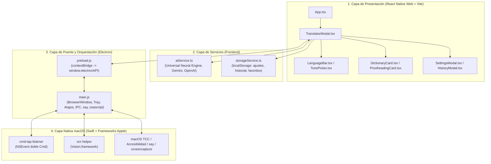

# 🌌 Astro — Traductor Universal IA (macOS + React Native)

**Astro** es una aplicación de escritorio modal de ultra-baja latencia (<200 ms) inspirada en Spotlight y Raycast, construida con componentes declarativos de **React Native** (`react-native-web`) y un runtime nativo para macOS con integración profunda a nivel sistema.

Diseñada y construida siguiendo estrictamente la especificación de requerimientos en [`docs/definicion.md`](./docs/definicion.md).

---

## 🚀 Características Principales

### 1. Invocación y Activación Global
* **Atajo Global Principal:** Invocación instantánea desde cualquier parte del sistema operativo mediante `Cmd + Alt + D`.
* **Hook Nativo `Cmd + Cmd`:** Soporte para activación rápida por doble pulsación de la tecla Command (`Cmd`), implementado con un monitor global de eventos nativo de macOS (`NSEvent.addGlobalMonitorForEvents`).
* **Comportamiento Efímero:** Ocultamiento instantáneo al hacer clic fuera del modal (`blur`) o al presionar la tecla `Esc`, liberando recursos de cómputo en segundo plano.
* **Ícono de Barra de Menú (Tray):** Acceso rápido con un clic desde la barra de estado de macOS.

### 2. Captura Inteligente y Automática
* **Lectura Automática:** Al activarse mediante el atajo, Astro detecta automáticamente si hay texto seleccionado en la aplicación activa en foco y lo transfiere al modal iniciando la traducción inmediatamente.
* **Fallback a Portapapeles:** Si no hay texto seleccionado, lee el contenido actual del portapapeles.

### 3. Lógica de Idiomas Inteligente
* **Detección Automática por IA:** Identifica el idioma del texto ingresado sin intervención manual.
* **Regla Condicional Inteligente:** 
  * Idioma predeterminado de destino: **Español**.
  * Si la detección automática determina que el texto de origen es Español, el destino conmuta automáticamente a **Inglés** (`es` → `en`).
* **Fijación de Idioma (Pin 📍):** Permite fijar un idioma de destino para evitar alternancias automáticas cuando se requiera.
* **Inversión Rápida (⇄):** Botón para alternar origen y destino con un solo clic.

### 4. Características Avanzadas (Nice-to-Have Integradas)
* **Reemplazo en Línea (`Auto-Replace` `Cmd + Enter`):** Con un clic o presionando `Cmd + Enter`, Astro oculta el modal, regresa el foco a la aplicación que estabas usando y reemplaza el texto seleccionado original con la traducción generada.
* **Ajuste de Tono (Contexto IA):** Botones rápidos para ajustar el registro de traducción:
  * ⚡ **Estándar**
  * 👔 **Formal**
  * 💬 **Informal**
  * ⚙️ **Técnico**
  * ✂️ **Resumido**
* **Modo Diccionario Extendido:** Si la entrada es una sola palabra, el sistema activa automáticamente una ficha léxica con fonética, categoría gramatical, definición detallada y ejemplos prácticos de uso.
* **Modo Corrector / Mejora de Redacción (Proofreading):** Si el idioma de origen y destino coinciden (ej. Español a Español), el motor analiza la sintaxis, ortografía y estilo, proponiendo mejoras.
* **Reconocimiento de Texto en Pantalla (OCR `Cmd + Alt + O`):** Selector de área interactivo con el puntero (`screencapture -i`) conectado al framework neuronal nativo de Apple (`Vision.framework` / `VNRecognizeTextRequest`) para extraer texto de capturas de pantalla, PDFs no seleccionables o imágenes sin instalar bibliotecas pesadas de terceros.
* **Síntesis de Voz (Text-to-Speech):** Reproducción de audio nativa con las voces oficiales del sistema operativo macOS (`say` / Web Speech) tanto para el texto de origen como para la traducción.
* **Historial y Favoritos:** Registro local persistente de las últimas 50 traducciones con filtrado de favoritas (⭐) y recarga instantánea.

### 5. Proveedores de IA y Streaming de Baja Latencia
* **Motor Local Inteligente (Zero-Config / Offline):** Viene activado por defecto para funcionar inmediatamente sin configurar API keys, con streaming fluido token por token (~16ms por token).
* **Google Gemini API:** Soporte para Gemini 1.5 Flash mediante streaming Server-Sent Events (SSE).
* **OpenAI API:** Soporte para GPT-4o-mini con streaming de alta velocidad.

---

## 🛠️ Atajos de Teclado del Sistema

| Atajo | Acción |
|---|---|
| `Cmd + Alt + D` | Abrir / Ocultar modal de Astro (Spotlight style) |
| `Cmd + Cmd` (Doble tap) | Invocar rápidamente Astro desde cualquier aplicación |
| `Cmd + Enter` | Reemplazar texto seleccionado en la app de fondo (`Auto-Replace`) |
| `Cmd + Alt + O` | Capturar área de pantalla con OCR (`Apple Vision`) |
| `Esc` | Cerrar / Ocultar ventana efímera |

---

## 📦 Instalación y Ejecución

### Prerrequisitos
* macOS (Probado en macOS Sonoma / Sequoia)
* Node.js v18+ y npm
* Xcode Command Line Tools (`swiftc` para compilar los helpers nativos de OCR y atajos)

### Pasos de Inicio

1. **Instalar dependencias:**
   ```bash
   npm install
   ```

2. **Compilar módulos nativos y UI:**
   ```bash
   npm run build
   ```

3. **Ejecutar Astro:**
   ```bash
   npm start
   ```

*(O en modo desarrollo con recarga rápida)*:
```bash
npm run dev
```

### 💿 Generar Instalador `.dmg` para macOS

Para empaquetar la aplicación en una imagen de disco instalable (`.dmg`):
```bash
npm run dist:dmg
```
El archivo instalador generado se ubicará en la carpeta:
`release/Astro-1.0.0.dmg`

---

## 🔒 Permisos de Accesibilidad en macOS

Para que macOS permita la detección de la doble pulsación rápida `Cmd + Cmd` y el reemplazo en línea con simulación de teclado en aplicaciones de terceros:
1. Abre **Ajustes del Sistema > Privacidad y Seguridad > Accesibilidad**.
2. Asegúrate de habilitar **Electron** o **Astro**.
3. En el modal de Astro, haz clic en el botón de **Ajustes (⚙️)** para validar el estado de los permisos en tiempo real.

---

## 📁 Estructura del Proyecto

```
traductor/
├── AGENTS.md                  # Reglas del proyecto
├── package.json               # Dependencias y scripts
├── tsconfig.json              # Configuración TypeScript
├── vite.config.mts            # Empaquetador ultra-rápido para React Native Web
├── index.html                 # Shell HTML con fondo translúcido y fuentes SF Pro
├── docs/                      # Documentación del proyecto
│   ├── definicion.md          # Especificación de requerimientos
│   ├── YYYY-MM-DD_HH-mm_implementation_plan.md
│   ├── YYYY-MM-DD_HH-mm_scratchpad.md
│   └── YYYY-MM-DD_HH-mm_walkthrough.md
├── native/                    # Módulos nativos en Swift
│   ├── cmd-tap-listener.swift # Monitor global de doble Cmd
│   └── ocr-helper.swift       # OCR nativo con Apple Vision
├── bin/                       # Binarios compilados
│   ├── cmd-tap-listener
│   └── ocr-helper
├── electron/                  # Bridge nativo para macOS
│   ├── main.js                # Proceso principal, atajos globales y ventana modal
│   └── preload.js             # API segura expuesta al frontend
└── src/                       # Código fuente en React Native
    ├── App.tsx                # Contenedor raíz con tema dinámico
    ├── index.tsx              # Registro de App con AppRegistry
    ├── types/                 # Tipos TypeScript
    ├── services/
    │   ├── aiService.ts       # Motor IA (Gemini, OpenAI, Motor Local y streaming)
    │   └── storageService.ts  # Persistencia de historial, favoritos y ajustes
    └── components/
        ├── TranslatorModal.tsx # Interfaz modal principal Spotlight/Raycast
        ├── LanguageBar.tsx     # Selector de idiomas, swap y pin
        ├── TonePicker.tsx      # Selector de tono (Formal, Informal, etc.)
        ├── DictionaryCard.tsx  # Ficha de modo diccionario extendido
        ├── ProofreadingCard.tsx# Ficha de modo mejora de redacción
        ├── HistoryModal.tsx    # Modal de historial y favoritos
        └── SettingsModal.tsx   # Modal de configuración y accesibilidad
```

---

## 🏗️ Arquitectura de la Aplicación

Astro sigue una **arquitectura híbrida en 4 capas** que combina una interfaz declarativa en React Native Web con un proceso principal de Electron y binarios nativos compilados en Swift para integración profunda con macOS.



### Descripción de Capas

1. **Capa de Presentación (`src/components/`, `src/App.tsx`):**
   Interfaz construida con `react-native-web` y empaquetada con Vite. Renderiza el modal flotante estilo Spotlight/Raycast (`TranslatorModal`), los controles de idioma y pines independientes (`LanguageBar`: pin de idioma destino e inmovilización de ventana), selector de tono (`TonePicker`) y tarjetas contextuales (`DictionaryCard`, `ProofreadingCard`).
2. **Capa de Servicios (`src/services/`):**
   - `aiService.ts`: Enruta las peticiones hacia el **Motor Neuronal Universal** por defecto (sin API Key, vía `translate.googleapis.com/translate_a/single?client=gtx`, `api.dictionaryapi.dev` y fallback offline) o hacia **Google Gemini** / **OpenAI** con streaming SSE.
   - `storageService.ts`: Persiste en `localStorage` la configuración del usuario, onboarding, voces seleccionadas y las últimas 50 traducciones con favoritos.
3. **Capa de Puente y Orquestación (`electron/`):**
   - `preload.js`: Expone `window.electronAPI` con `contextIsolation: true` y `nodeIntegration: false`.
   - `main.js`: Administra el ciclo de vida de la ventana transparente (`alwaysOnTop`, ocultar al perder foco salvo que esté fijada), el ícono de Tray, atajos globales (`Cmd+Alt+D`, `Cmd+Alt+O`), captura de selección y `Auto-Replace` vía `osascript`, síntesis de voz nativa (`say`) y verificación dinámica de permisos de Accesibilidad.
4. **Capa Nativa macOS (`native/` → `bin/`):**
   Binarios compilados con `swiftc` e incluidos en `extraResources`:
   - `cmd-tap-listener`: Monitor global de eventos (`NSEvent`) para detectar la doble pulsación rápida `Cmd+Cmd`.
   - `ocr-helper`: Extrae texto de capturas interactivas (`screencapture -i`) mediante `Vision.framework`.
